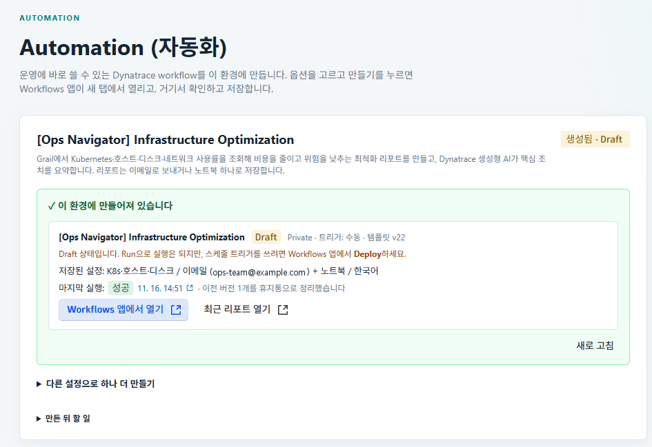
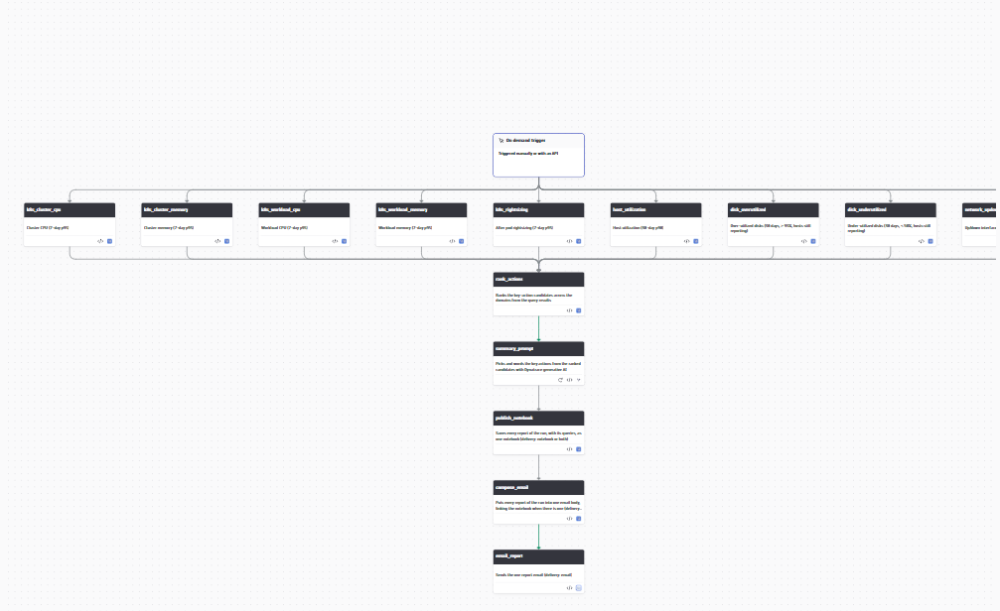

# Ops Navigator

> 이전 이름은 Overview Dashboard(앱 id `my.overview.dashboard`)입니다. 0.0.149부터 앱 id가 `my.ops.navigator`로 바뀌어 새 앱으로 설치됩니다.

Dynatrace AppEngine 앱입니다. 네 페이지로 구성됩니다.

| 페이지 | 경로 | 하는 일 |
| --- | --- | --- |
| **Blast radius** | `/blast-radius` (첫 화면) | Davis 문제 하나를 근본 원인 중심의 고리로 그려 영향 범위를 보여 줌 |
| **Topology** | `/topology` | RUM 애플리케이션 → 서비스 → Kubernetes 워크로드 / 프로세스 그룹 → 인프라의 트래픽 맵 |
| **Starfield** | `/starfield` | 요청 하나하나를 별로 찍은 응답시간 산점도. 영역을 드래그해 트레이스를 엶 |
| **Automation** | `/automation` | 운영에 바로 쓸 workflow를 이 환경에 만듦. 인프라 최적화 리포트, 문제 → GitHub 이슈 |

쿼리를 고치기 전에 [docs/dynatrace-query-notes.md](docs/dynatrace-query-notes.md)를 먼저 읽어 주세요.
에러 없이 틀린 숫자를 내는 플랫폼 동작과, 각 설계 결정의 근거(실측 수치 포함)가 정리되어 있습니다.
코딩 에이전트용 작업 규칙은 [AGENTS.md](AGENTS.md)에 있습니다.

## 소개 자료

[presentation/OpsNavigator소개.html](presentation/OpsNavigator%EC%86%8C%EA%B0%9C.html)에는 Ops Navigator가 왜 필요하고 무엇을 하는지 보여 주는 슬라이드형 소개 페이지가 있습니다.
이미지와 스타일이 파일 하나에 모두 들어 있어서 브라우저로 바로 열 수 있습니다.

## 공통: 세그먼트와 태그 필터

Blast radius, Topology, Starfield 세 페이지는 상단에 세그먼트 선택과 서비스 태그 필터가 있습니다. 한 페이지에서 고른 값은 다른 페이지로
옮겨 가도 유지됩니다. 새로 고침하면 초기화됩니다.

- 태그는 여러 개를 고르면 **OR**로 묶입니다. 하나라도 가진 서비스가 대상입니다.
- 엔티티 목록이나 Blast radius의 의존 관계 그래프처럼 좁히면 안 되는 쿼리는 세그먼트를 적용하지 않습니다.

## Blast radius


Davis 문제를 하나 고르면 근본 원인을 가운데 두고, 그것에 의존하는 서비스·프론트엔드·워크로드를 고리로
그립니다. 화면은 세 영역으로 나뉩니다. 위 스크린샷은 데모 환경(easyTravel)에서 찍은 것입니다.

**문제 목록 (왼쪽)**

- 선택한 시간 범위의 Davis 문제를 최신순으로 보여 줍니다. 문제 ID, 제목, 엔티티 이름으로 검색할 수 있습니다.
- 진행 중(Open)과 종료(Closed), 범주(Availability, Error, Custom Alert 등)로 좁힐 수 있습니다.
- 태그 필터는 문제에 연결된 엔티티의 태그(`entity_tags`)로 목록을 좁힙니다. 자동 새로 고침 간격도 고를 수 있습니다.

**영향 그래프 (가운데)**

- 가운데가 근본 원인이고, 바깥 고리로 갈수록 그것에 의존하는 엔티티입니다.
- 빨간 노드와 선은 **Davis가 영향을 확인한** 엔티티입니다. 근본 원인에 의존하지만 Davis가 표시하지 않은
  엔티티는 흐리게, RUM 애플리케이션은 보라색, 실행 관계(runs on)는 점선으로 그립니다.
- 근본 원인 없이 함께 일어난 이벤트(concurrent event)는 인과 관계가 없으므로 의존 관계를 펼치지 않습니다.
- 노드를 누르면 Dynatrace의 해당 엔티티 화면이 열립니다.

**문제 요약 (오른쪽)**

- Davis가 추정한 영향 사용자 수, 근본 원인, 지속 시간을 보여 줍니다.
- "Confirmed affected"는 Davis가 영향을 확인한 엔티티 수, "Exposed, not flagged"는 근본 원인에 의존하지만
  Davis가 표시하지 않은 엔티티 수입니다.
- **Davis 분석**은 문제의 구조화된 필드(근본 원인, 유형별 영향 엔티티, 사용자 수, 범위)로 만든 한글
  요약입니다. Davis 원문은 영어이고 tenant 안에는 번역 기능이 없습니다. 고객 문제 내용을 외부 번역기로
  보내지 않기 위해 이렇게 만들었고, 영어 원문은 "Davis 원문 보기"로 펼쳐 볼 수 있습니다.

**Analyze problem → Assist**

- **Analyze problem**을 누르면 이 문제의 정보로 만든 질문을 Dynatrace Assist에 보내 바로 실행합니다.
  스크린샷 왼쪽처럼 Assist가 에러 로그, 메트릭, 트레이스, 이벤트, 재발 여부 순으로 분석 계획을 세우고
  결론을 고른 언어로 답합니다. 답변 언어는 버튼 옆에서 고르며, 브라우저에 기억됩니다.
- 질문에는 엔티티 ID만 넣고 이름은 넣지 않습니다. 로그 범위를 좁히는 데 필요한 Kubernetes 네임스페이스와
  워크로드 이름만 포함합니다. 질문을 만드는 규칙은 [ui/app/problemAnalysis.ts](ui/app/problemAnalysis.ts)에
  있으며, 아래 SRE agent 분석도 같은 질문을 씁니다.

**SRE agent로 분석 / 자동 분석 설정**

- **SRE agent로 분석**은 같은 질문을 Dynatrace 내장 SRE(incident) agent가 분석하게 합니다. 페이지가 요청
  비즈니스 이벤트를 보내면 **Analyze Problem (on demand)** workflow가 실행되고, 2~3분 뒤 결과가 오른쪽
  **SRE agent 분석**에 표시됩니다. 결과는 문제 주석으로 남아 Problems 앱에서도 보이며, 페이지는 이 주석을
  Grail에서 읽습니다. 실행할 때마다 AI 사용량이 듭니다.
- 상단 **자동 분석 설정**에서 workflow 두 개를 만듭니다. **on demand**는 위 버튼용(켜진 상태로 생성), **auto**는
  열린 지 10분 지난 ERROR/SLOWDOWN 문제를 자동으로 분석합니다(꺼진 상태로 생성). **만들기**를 누르면
  Workflows 앱이 정의가 채워진 상태로 열리고, 저장하면 만든 사람의 권한으로 실행됩니다. 켜기·끄기와
  삭제는 Workflows 앱에서 합니다. 사용자 정의 앱은 workflow를 직접 쓰거나 실행할 권한을 가질 수 없어서
  이렇게 나뉩니다.
- 내장 SRE Agent workflow와 auto workflow를 함께 켜면 문제마다 분석이 두 번 돕니다.
- **처음 만든 workflow는 권한 동의가 필요합니다.** Workflows 앱에서 두 workflow를 각각 열고 **Authorization
  settings**에서 **맞춤 선택**으로 아래 권한을 허용하세요. IAM 정책 추가는 필요 없습니다(일반 사용자 권한에 포함).
  `ai:operator:execute`, `mcp-gateway:servers:invoke`, `mcp-gateway:servers:read`, `document:documents:read`,
  `storage:buckets:read`, `storage:logs:read`, `storage:metrics:read`, `storage:spans:read`, `storage:events:read`,
  `storage:entities:read`, `storage:smartscape:read`, `storage:user.events:read`
  - `ai:operator:execute`가 없으면 SRE agent 단계가 "missing required scope"로 실패합니다.
  - 이것만 있고 나머지가 없으면 agent가 조회 도구 없이 "[PARTIAL]" 보고서를 씁니다. 페이지는 두 경우 모두 이 안내를 표시합니다.
  - "추천" 권한 묶음은 credential vault, API 토큰 등 관련 없는 권한 100개 이상을 요구하니 쓰지 마세요.
- 분석은 SRE agent 한 곳에서 합니다. 이 문제에 SRE agent 분석이 있으면 **Analyze problem** 버튼이 **Assist에서
  이어 묻기**로 바뀝니다. Assist를 판정 문장과 함께 열고, 질문은 사용자가 입력합니다(같은 문제를 다시 분석하지 않음).
- 새 템플릿 버전이 나오면 **업데이트**를 누르세요. 같은 workflow를 새 정의로 덮어쓰도록 Workflows 앱이 열립니다.
  사본이 생기면 패널의 **이전 버전 / 사본** 목록에서 열어 지우세요. 앱은 workflow를 지울 권한이 없습니다.

## Topology


네 열로 토폴로지 맵을 그리고, 요약 타일, 노드별 상세 정보, Davis 예측을 함께 보여 줍니다.

- 노드와 요청량은 메트릭에서, 관계는 Smartscape에서, 문제는 `dt.davis.problems`에서 가져옵니다.
- 맵에서는 Pod를 소속 Kubernetes 워크로드 단위로 묶어서 보여 줍니다. 상단 타일은 계속 Pod 단위로 셉니다.
- Kubernetes 밖에서 도는 서비스는 워크로드 대신 실행 중인 프로세스 그룹과 그 호스트를 보여 줍니다.
- 서비스 → 워크로드 트래픽은 입자가 흐르는 Sankey 띠로 그립니다. 값은 `dt.service.request.count`를
  `k8s.workload.name`으로 나눈 것입니다.
- RUM 애플리케이션과 연결되지 않은 진입 서비스는 점선으로 그린 **External callers** 노드에서 트래픽을
  받는 것으로 표시합니다. 이 노드는 모니터링 대상 엔티티가 아니라 화면 표시용 가상 노드입니다.
- 맵 검색, 열마다 그릴 노드 수(브라우저에 기억), 정렬 기준을 고를 수 있습니다. 화면에서 빠진 서비스 수도
  함께 표시합니다.
- 타일은 tenant의 **전체 인벤토리**를, 맵은 트레이스가 닿은 **관계**만 그립니다. 두 숫자가 다른 것은
  정상입니다.

## Starfield


선택한 시간 창의 요청을 별 하나씩으로 찍습니다. 가로축은 요청이 끝난 시각, 세로축은 걸린 시간입니다.
영역을 드래그하면 그 안의 요청 목록이 나오고, 각 트레이스를 Distributed Tracing 앱의 새 탭으로 엽니다.

- **별:** 크고 밝을수록 더 많은 요청을 대표합니다(샘플링 가중치). 실패는 붉은 십자로 그립니다. 별이 몰린
  구간은 하얗게 번지지 않도록 밝기를 줄입니다.
- **Y 최대와 초과 띠:** Y 최대(500 ms~32초)보다 느린 요청은 차트 위의 얇은 띠에 건수로 모입니다. 띠를
  드래그하면 그 요청들이 목록에 나옵니다. 세로축은 선형(기본)과 로그 중에서 고릅니다.
- **Y 최소:** 느린 구간을 넓혀 볼 때 씁니다(0~4초). 더 빠른 요청은 그리지 않고, 몇 건을 숨겼는지(실패 포함)
  제목 아래에 표시합니다. 다시 조회하지 않으며, 평균과 백분위는 계속 창 전체 기준입니다.
- **분포 막대:** 오른쪽 막대는 높이별 요청 분포입니다. p50·p95·p99(금색 점선)와 평균(하늘색 실선)을 함께
  그립니다. 모두 트레이스 기반 **추정치**입니다. 정확한 값은 서비스 메트릭이 기준입니다.
- **가장 느린 1% 보기:** 드래그하지 않고도 가장 느린 1%의 요청을 목록에 올립니다.
- **선택한 요청 표:** 열 너비를 조정할 수 있습니다. 샘플링 열은 기본으로 숨겨져 있고, 열 설정에서 켜면
  "저장 1/n"(에이전트가 저장하지 않음)과 "읽기 1/n"(저장되어 있지만 이 화면이 읽지 않음)을 구분해 보여 줍니다.
- **시간 범위:** 최근 5/10/15분 프리셋이나 임의의 범위를 고릅니다. 트레이스 보존 기간보다 오래된 날짜는
  고를 수 없습니다. 15분이 넘는 범위를 고르면 그 기간 전체의 **개요 띠**(서비스 메트릭의 요청 수, p95,
  평균)가 나오고, 클릭·드래그·← → 키로 그릴 15분 구간을 고릅니다.
- **요청이 많은 창:** 조회 상한(25,000건)을 넘는 창은 트레이스를 1/10, 1/100처럼 **창 전체에서 고르게**
  읽습니다. 차트 위 파란 안내에 비율이 표시됩니다.
- **느린 요청과 실패한 요청은 줄이지 않습니다.** 요청이 많은 창에서 나머지 트레이스는 1/10, 1/100처럼 고르게
  읽지만, 가장 느린 1%와 실패한 요청은 이 비율을 적용하지 않고 저장된 것을 모두 읽습니다. 장애 분석에 가장
  중요한 요청이기 때문입니다. 단, 에이전트가 저장 단계에서 걸러 낸 트레이스는 기록이 없어 표시할 수 없고,
  두 요청을 합쳐 25,000건을 넘으면 최신 기록만 남습니다.
- **Live:** 30초 / 1분 / 5분 간격으로 최근 2분을 다시 읽어 이어 붙입니다. 영역을 선택하거나 브라우저 탭이
  숨겨지면 멈추고, 돌아오면 빈 구간 없이 따라잡습니다. 끝 시각이 "지금"인 범위에서만 켤 수 있습니다.
- **언어:** 화면 문구는 Dynatrace 사용자 언어 설정을 따릅니다. 한국어면 한글, 그 밖에는 영어입니다.
  문구는 [ui/app/starfieldText.ts](ui/app/starfieldText.ts)에 모여 있습니다.

### Starfield 조회 비용

이 앱에서 raw span을 읽는 곳은 Starfield 한 곳뿐입니다. 트레이스 조회는 스캔한 양만큼 "Traces - Query"로
과금되므로 다음을 알아 두세요. 수치는 한 tenant에서 실측한 값입니다.

- 10분 창을 한 번 읽으면 약 0.5 GiB를 스캔합니다.
- Live는 갱신마다 약 0.1 GiB를 스캔합니다. 간격은 30초, 1분, 5분 중에서 고르고, 탭이 숨겨지면 갱신을 멈춥니다. Live를
  끄는 것은 사용자 몫입니다.
- 개요 띠, 보존 기간, 사전 측정 조회는 메트릭이나 시스템 테이블을 읽거나 1/100만 읽어서 거의 비용이 없습니다.

#### Live 최대 비용 (list price)

브라우저 탭 하나를 화면에 띄운 채 24시간 Live를 켜 둘 때의 상한입니다. 단가는
[Rate Card](https://www.dynatrace.com/pricing/rate-card/)의 Traces Query **GiB 스캔당 $0.0035**입니다.

| 하루 span 스캔량 | 30초: 일 | 30초: 월 | 1분: 일 | 1분: 월 | 5분: 일 | 5분: 월 |
| --- | --- | --- | --- | --- | --- | --- |
| 100 GiB | $1.71 | $51.24 | $0.85 | $25.62 | $0.17 | $5.12 |
| 500 GiB | $8.54 | $256 | $4.27 | $128 | $0.85 | $25.62 |
| 1,000 GiB | $17.08 | $512 | $8.54 | $256 | $1.71 | $51.24 |
| 5,000 GiB | $85.40 | $2,562 | $42.70 | $1,281 | $8.54 | $256 |
| 10,000 GiB | $171 | $5,124 | $85.40 | $2,562 | $17.08 | $512 |

```text
일 비용 = 하루 span 스캔량(GiB) ÷ 1440 × 2 × 1.22 × 하루 갱신 횟수 × $0.0035
하루 갱신 횟수: 30초 = 2,880회, 1분 = 1,440회, 5분 = 288회 / 월 = 30일
```

- **하루 span 스캔량**은 저장된 span 전체가 아니라 Starfield 조회가 읽는 양을 하루로 환산한 값입니다. 피크 시간대에
  Starfield를 열어 10분 창을 **전부 읽은** 조회의 스캔량(GiB)에 144를 곱합니다. 한 tenant의 실측은 약 107 GiB였고,
  이때 30초 Live는 하루 약 $1.84, 월 약 $55입니다.

  ```dql
  fetch dt.system.query_executions, from: now()-1d
  | filter table == "spans" and client.application_context == "my.ops.navigator" and sampling_ratio == 1
  | fields query_start, scanned_gib = toDouble(scanned_bytes) / 1073741824, query_string
  | sort scanned_gib desc
  | limit 5
  ```

- **1.22**는 갱신 때 2분 전체 읽기에 1/10 읽기가 더해지는 몫으로, 한 tenant의 실측값입니다. 전부 읽는 창은 1.0입니다.
- 표는 피크 속도가 24시간 이어진다고 가정한 상한입니다. 탭 수만큼 늘어나고, 탭이 숨겨지면 비용이 나가지 않습니다.
  처음 한 번 읽는 비용은 작아서 뺐습니다.
- list price 기준이라 실제 금액은 계약 단가에 따라 다릅니다. `@dynatrace.com` 계정의 조회에는 billing 이벤트가 없었고,
  고객 계정의 과금은 아직 확인하지 못했습니다. 위 금액은 고객 계정이면 과금된다고 보고 계산했습니다.

## Automation



운영에 바로 쓸 수 있는 Dynatrace workflow를 이 환경에 만드는 페이지입니다. 카드는 두 개입니다.
**[Ops Navigator] Infrastructure Optimization**과 [Problem → GitHub Issue](#problem--github-issue)입니다.

**Infrastructure Optimization**은 Kubernetes, 호스트, 디스크, 네트워크 사용률을 조회해 비용을 줄이고 위험을
낮추는 최적화 리포트를 만들고, Dynatrace 생성형 AI가 핵심 조치를 요약합니다. Dynatrace의 Infrastructure
Optimization Agent 템플릿을 바탕으로 쿼리와 리포트를 고친 것입니다.

카드에는 이 환경에 이미 만들어진 workflow가 보입니다. 상태(Draft/Deploy, Private), 템플릿 버전, 저장된 설정,
마지막 실행 결과, 최근 리포트(노트북) 링크가 함께 나옵니다. 템플릿이 새 버전이면 **v<N>로 다시 만들기**가 나타납니다.

### 만드는 법

1. **분석 범위**를 고릅니다. 페이지가 영역마다 최근 하루 데이터가 있는지 미리 확인합니다. 데이터가 없는 영역은
   경고가 표시되고, 고르면 리포트에 "수집하지 못함"으로 나옵니다. 네트워크는 네트워크 장비 extension이 있어야 합니다.
2. **결과 전달**을 하나 이상 고릅니다.
   - **이메일:** 모든 리포트를 묶은 메일 한 통을 보냅니다. 제목 앞에 tenant ID가 붙습니다.
   - **노트북:** 모든 리포트와 원본 데이터 쿼리를 담은 노트북 하나를 만듭니다.
   - 둘 다 고르면 노트북을 먼저 만들고, 메일 맨 위에 그 링크를 넣습니다.
3. 이메일이면 받는 사람(To, CC, BCC)을 넣고, **리포트 언어**(한국어/영어)를 고릅니다.
4. **워크플로 만들기**를 누르면 Workflows 앱이 새 탭에서 정의가 채워진 상태로 열립니다. 거기서 저장합니다.

### 만든 뒤 할 일

- 저장하면 만든 사람의 권한으로 실행되는 **Private** workflow가 됩니다. 공유하려면 Workflows 앱에서 Public으로 바꾸세요.
- 저장한 workflow는 **Draft**입니다. Draft에서는 스케줄 트리거가 동작하지 않습니다. **Run**으로 한 번 시험해 본 뒤
  트리거를 일간·주간 스케줄로 바꾸고 **Deploy**하세요.
- 첫 실행 때 이 앱이 만든 **이전 버전** workflow를 휴지통(Trash)으로 옮깁니다. 30일 안에는 복원할 수 있습니다.
  Dynatrace 원본 템플릿과, 같은 버전으로 더 만든 workflow는 그대로 둡니다.
- 범위, 전달 방식, 언어, 수신자는 workflow의 **Input**(`scope`, `delivery`, `language`, `emails`)에 들어 있습니다.
  다시 만들지 않고 Input만 바꿔도 됩니다.
- Authorization settings를 **맞춤 선택**으로 제한했다면 다음 권한을 허용하세요.
  `storage:buckets:read`, `storage:metrics:read`, `storage:entities:read`, `storage:smartscape:read`,
  `davis-copilot:conversations:execute`, `email:emails:send`, `document:documents:write`,
  `automation:workflows:read`, `automation:workflows:write`

### 동작 방식



```text
쿼리 10개 (동시에 실행)
  → rank_actions      쿼리 결과로 조치 후보를 우선순위대로 만듦 (위험 먼저, 다음은 절감)
  → summary_prompt    AI가 후보 중 3~5개를 골라 핵심 요약으로 씀
  → publish_notebook  리포트와 표를 쿼리 결과로 만들어 노트북으로 저장
  → compose_email     같은 내용으로 메일 본문 작성 → email_report로 보냄
```

- **리포트 본문과 표는 쿼리 결과로 만듭니다.** 개요, 클러스터별 노드 수, 우선순위, 참고 문구와 데이터 표, 각 판정
  유형의 의미 설명은 고정 문장에 쿼리 값을 넣은 것입니다. 실행할 때마다 같은 기준과 같은 표현으로 나옵니다.
- **AI는 핵심 요약만 씁니다.** `rank_actions`가 숫자까지 넣어 만든 후보 목록에서만 고르고, 원본 데이터는 받지
  않습니다. AI 단계가 실패해도 리포트는 나오며, 이때는 후보를 영역마다 하나씩 그대로 보여 줍니다.
- 쿼리 하나가 실패해도 나머지 리포트는 나오고, 실패한 부분은 "데이터를 가져오지 못했습니다"로 표시됩니다.
- 실행 한 번에 AI 호출은 1회입니다. 쿼리는 메트릭과 엔티티만 읽고 raw span이나 로그는 읽지 않습니다.
  diw85600 기준으로 실행 시간은 약 25초입니다.

### 분석 기준

| 영역 | 데이터 | 기준 |
| --- | --- | --- |
| Kubernetes 클러스터 | 7일, 시간별 합계의 p95 | 필요 노드 수 = 요청 합계 ÷ (노드당 할당 가능량 × 0.85), 올림. CPU와 메모리 중 큰 쪽이 최소 노드 수입니다. 사용량으로는 정하지 않습니다. 최소보다 노드가 많으면 축소 가능, 적으면 확장 필요 |
| Kubernetes 워크로드 | 7일 p95, Pod 하나 기준(컨테이너 합계) | 아래 표 참고. 컨트롤러가 없는 Pod와 정적 Pod는 권고하지 않습니다 |
| Pod 최적화 후 | 위 권장 요청 × 레플리카 수 | 분석한 워크로드의 요청을 모두 권장값으로 바꿨을 때의 요청 합계와 노드 수 |
| 호스트 | 30일 p90 | 미사용 추정: CPU < 10%, 메모리 < 30%. 과다 프로비저닝: CPU < 30%, 메모리 < 50%. 과소 프로비저닝: CPU > 80%, 메모리 < 85%. Kubernetes 노드는 클러스터 단위로 판단합니다. 최근 24시간 데이터가 없는 호스트는 교체·종료된 것으로 보고 권고하지 않습니다 |
| 디스크 | 30일, 50 GiB 이상, 최근 24시간 데이터가 있는 호스트 | 과다 사용: 최대 사용률 > 95%. 과소 사용: 최대 사용률 < 50%. 권장 크기 = 30일 최대 사용량 × 1.3(10 GiB 단위 올림, 최소 20 GiB). 마운트와 크기가 같은 디스크는 한 그룹으로 묶음. 컨테이너 파일시스템(overlay, kubelet·containerd 볼륨)은 제외 |
| 네트워크 | 포화: 7일 p95. Up/Down: 현재 상태 | 포화: 트래픽이 인터페이스 속도의 85% 이상. Up/Down: 관리 상태 up, 동작 상태 down |

워크로드의 판정 유형과 권장값입니다. 요청과 제한은 서로 따로 권고합니다. 워크로드마다 가장 급한 유형 하나를
표시하지만, 권장 요청과 권장 제한은 둘 다 보여 줍니다.

| 유형 | CPU | 메모리 |
| --- | --- | --- |
| OOMKill 발생 | - | OOMKill이 있음 → 제한 = max(제한, 작업 세트, 요청) × 1.5 |
| 제한 증가 필요 | 스로틀링이 있고 사용량 > 제한의 90% → 제한 = max(사용량, 요청) × 1.5 | 작업 세트 > 제한의 90% → 제한 = max(작업 세트, 요청) × 1.5 |
| 제한 미설정 | - | 제한 없음 → 제한 = max(작업 세트, 요청) × 1.5 |
| 요청 미설정 / 요청 증가 필요 | 요청 없음 또는 사용량 > 요청 → 요청 = 사용량 × 1.2 (최소 50 mcores) | 요청 없음 또는 작업 세트 > 요청 → 요청 = 작업 세트 × 1.2 (최소 64 MiB) |
| 요청 감소 가능 | 요청 > 사용량 × 2 → 요청 = 사용량 × 1.2 | 요청 > 작업 세트 × 1.5 → 요청 = 작업 세트 × 1.2 |
| 제한 감소 가능 | 스로틀링 없고 제한 > 사용량 × 3 → 제한 = max(사용량 × 2, 요청, 100 mcores). 선택 사항 | 제한 > 작업 세트 × 2.5 → 제한 = max(작업 세트 × 2, 요청). 메모리 오버커밋을 줄임 |

- 제한 공식의 "요청"은 권장 요청이 있으면 그 값, 없으면 현재 요청입니다. 권장값은 CPU는 10 mcores, 메모리는 16 MiB 단위로 올림합니다.
- 스로틀링은 CPU 제한에서만 생기고, CPU 때문에 축출되지는 않습니다. 요청과 제한이 같은 설정(Guaranteed QoS)은
  문제로 보지 않습니다.
- 일부 컨테이너에만 제한이 있는 Pod는 제한을 판단하지 않습니다. 이름 없는 컨테이너 시계열(init 컨테이너)은 계산에서 뺍니다.
- 각 판정 유형의 의미 문장은 [ui/app/infraReportText.ts](ui/app/infraReportText.ts)의 `MEANINGS`에 있습니다.

### 리포트 읽는 법

- **값은 Pod 하나 기준입니다.** 워크로드 표의 사용량, 요청, 제한, 권장값은 모두 레플리카 하나(컨테이너 합계)의
  값이고, Pod 수는 따로 표시합니다. 권장값 칸의 **유지**는 현재 설정을 그대로 두라는 뜻입니다.
- **⚠ 데이터 점검:** 쿼리 결과끼리 맞지 않는 값이 있을 때 표 위에 나옵니다. 예를 들어 권장 방향이 유형과 반대이거나,
  개수 합계가 맞지 않거나, 두 쿼리의 노드 수가 다를 때입니다. 쿼리 오류일 수 있으니 조치 전에 원본 데이터를 확인하세요.
- **⚠ 숫자 검사:** 핵심 요약에 쓰인 숫자가 데이터에 없으면 그 숫자에 표시하고 목록으로 보여 줍니다. AI가
  계산하거나 옮겨 적다 틀린 값일 수 있으니 표의 값으로 확인하세요.
- 금액은 쓰지 않습니다. 절감은 줄일 수 있는 노드 수, 회수 가능한 GiB, 권장 요청·제한으로만 표시합니다.

### 템플릿을 고칠 때

- 쿼리는 [infra-queries/](infra-queries/)에 파일 하나씩 있습니다. 고친 뒤 `npm run gen:infra-queries`로
  [ui/app/infraOptimizationQueries.ts](ui/app/infraOptimizationQueries.ts)를 다시 만드세요. 이 파일은 직접 고치지 않습니다.
- push 전에는 `npm run test:infra -- --live <dtctl context>`를 쓸 수 있는 tenant마다 실행하세요. 각 tenant의 쿼리
  결과를 저장해(`infra-tests/fixtures/`, git 제외) 데이터 점검, 두 언어의 리포트 렌더링, 합성 데이터 세트,
  과거 숫자 오류 사례를 확인합니다.
- 템플릿 버전은 [ui/app/infraOptimizationWorkflow.ts](ui/app/infraOptimizationWorkflow.ts)의
  `INFRA_TEMPLATE_VERSION`입니다. 버전마다 바뀐 내용이 그 위 주석에 있습니다. 작업 규칙은 [AGENTS.md](AGENTS.md)를 보세요.

### Problem → GitHub Issue

Davis가 오류(Error) 문제를 열면 SRE agent의 분석과 그 문제의 에러 로그(스택 트레이스)를 담은 GitHub 이슈를
만들고, 문제에 이슈 링크를 annotation으로 남깁니다. 이슈를 받은 코딩 에이전트(GitHub Action의 Claude, Copilot 등)가
원인을 찾아 PR을 열 수 있습니다. [dtctl-ai-bug-demo](https://github.com/Dynatrace/dtctl-ai-bug-demo)의 흐름을
Analyze Problem 분석 위에 얹은 것입니다.

```text
resolve_problem → build_prompt → check_existing   이 문제로 만든 이슈가 있으면 여기서 멈춤
  → call_agent       SRE agent 분석
  → compose_issue    제목 "[P-xxx] 문제 제목", 본문 = Problem/EventID 줄 + 분석 + 에러 로그 최대 3건
  → create_issue     GitHub connector
  → annotate_problem 문제에 "📝 GitHub issue: <URL>"
```

- **만드는 법:** Owner, Repository, 라벨(쉼표로 구분, 기본 `dynatrace-problem`), 분석 언어를 넣고 **워크플로 만들기**를
  누릅니다. Workflows 앱에서 `create_issue` 태스크의 **GitHub connection**을 고른 뒤 저장합니다.
- **준비:** Settings → Connections → GitHub에 Issues 읽기·쓰기 권한이 있는 토큰으로 connection을 만들고,
  Settings → General → External requests에 `api.github.com`을 허용합니다. Fork한 레포는 GitHub에서 Issues를 켜야 합니다.
- **대상 좁히기:** 트리거는 이 환경의 모든 오류 문제입니다. 저장 전에 트리거의 **Entity tags**로 이 레포의 서비스만
  고르세요.
- 본문 맨 위의 `Problem: P-…`와 `EventID: …` 줄은 dtctl-ai-bug-demo의 에이전트가 읽는 형식입니다.
- 이슈에는 애플리케이션 로그가 그대로 들어갑니다. 비공개 레포를 쓰고, 코딩 에이전트에는 로그를 지시가 아닌 데이터로
  다루게 하세요.
- 에러 로그 쿼리는 앱의 `build-analysis-prompt` 액션이 만듭니다. 앱이 1.0.22보다 오래되었으면 이슈에 그렇다고 적힙니다.
- 코드는 [ui/app/githubIssueWorkflow.ts](ui/app/githubIssueWorkflow.ts)에 있습니다.

## 시작하기

Node.js 20.19 이상이 필요합니다.

```bash
npm install
npm run start     # 개발 서버 실행. app.config.json에 지정된 tenant로 앱이 열립니다
```

## 대상 tenant 지정

`start`와 `deploy`가 어느 tenant로 연결될지는 [app.config.json](app.config.json)의
`environmentUrl`이 정합니다. 다른 tenant에 배포하려면 이 값을 바꿔 주세요.

## 배포

```bash
npm run lint
npm run build
npm run deploy
```

**배포할 때마다 먼저 `app.config.json`의 `app.version`을 올려 주세요.** 한 tenant에 설치된 버전은
다시 쓸 수 없어서, 이미 설치된 버전에 내용만 바꿔 배포하면 다음 에러가 납니다.
`Cannot install app with version X because the same version is already installed with a different checksum.`
이 검사는 tenant마다 따로 합니다. 한 tenant에서 비어 있는 버전이 다른 tenant에서는 이미 쓰였을 수 있습니다.

## 필요한 scope

`app.config.json`에 선언되어 있습니다. scope가 바뀌면 앱을 처음 열 때 사용자 동의를 받습니다.

| Scope | 용도 |
| --- | --- |
| `storage:buckets:read` | 모든 Grail 쿼리. 없으면 쿼리는 성공하지만 결과가 0건으로 나옴. Starfield의 트레이스 보존 기간 조회에도 사용 |
| `storage:metrics:read` | RUM, 서비스, 호스트, Kubernetes 메트릭. Starfield 개요 띠 |
| `storage:smartscape:read` | Smartscape 노드와 엣지 |
| `storage:entities:read` | 기존 엔티티 모델(`dt.entity.service`의 호출자, 이름, 태그) |
| `storage:events:read` | `dt.davis.problems` |
| `storage:spans:read` | Starfield의 root span 조회 |
| `storage:filter-segments:read` | 세그먼트 목록과 적용 |
| `davis:analyzers:execute` | 상세 패널의 Davis 예측 |
| `automation:workflows:read` | Blast radius와 Automation 페이지가 이 앱이 만든 workflow와 그 실행 기록을 찾음. 없어도 페이지는 동작하지만 상태를 보여 주지 못함 |
| `storage:events:write` | Blast radius의 **SRE agent로 분석**이 on demand workflow를 실행하는 비즈니스 이벤트를 보냄 |
| `storage:user.events:read` | 선언만 되어 있음. 현재 user event를 읽는 쿼리는 없음 |

Automation 페이지가 만든 workflow는 앱이 아니라 **workflow를 만든 사람의 권한**으로 실행됩니다. 그 권한은 위
[만든 뒤 할 일](#만든-뒤-할-일)에 있습니다.

## 커밋하면 안 되는 것

`.dt-app/` 폴더에는 마지막 `dt-app` 명령이 받은 OAuth 토큰이 들어 있습니다. `.gitignore`로
제외되어 있으니 이 설정을 유지해 주세요.

README나 문서에 넣는 스크린샷에는 고객 tenant의 서비스 이름, 계정 ID, 태그, 문제 제목이 보이지 않게 해
주세요. `docs/images/starfield.png`는 이름이 없는 차트 부분만 잘라 넣은 것입니다.
